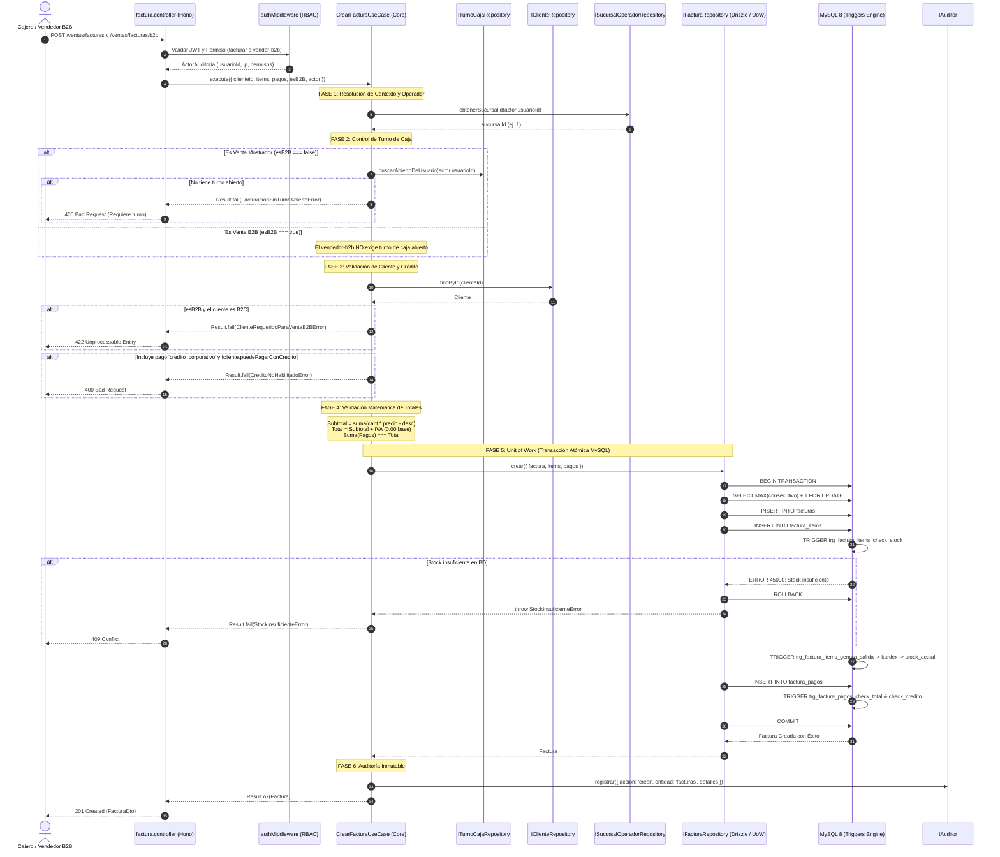

# Flujo Completo de Facturación y Unit of Work en Warengine

> **Módulo:** Facturación y Punto de Venta (POS)  
> **Patrones:** Clean Architecture · Domain-Driven Design (DDD) · Unit of Work · Hexagonal Ports & Adapters · Database-Driven Triggers  
> **Fecha de Elaboración:** Octubre 2026 · Warengine v2.0  

---

## 1. Introducción y Fundamentos Arquitecturales

El proceso de facturación en **Warengine** es el núcleo transaccional más sensible del sistema: involucra la emisión de comprobantes fiscales, la asignación de consecutivos por sucursal, la deducción física y lógica de inventario, el registro de múltiples medios de pago (divididos o a crédito) y la trazabilidad de auditoría inmutable.

Para garantizar robustez absoluta ante concurrencia, evitar estados inconsistentes (huérfanos) y proteger la pureza del dominio, la solución se diseñó bajo tres pilares inquebrantables:

1. **Clean Architecture (Independencia de Frameworks y BD):** La lógica de negocio (`CrearFacturaUseCase`) reside en `packages/core` y desconoce la existencia de SQL, Drizzle o Hono. Solo interactúa con entidades de dominio (`Factura`, `FacturaItem`, `FacturaPago`) e interfaces abstractas (puertos).
2. **Unit of Work (Unidad de Trabajo Atómica):** Una venta no es un conjunto de operaciones sueltas; es una transacción ACID indivisible. Si la cabecera se guarda pero un pago falla, o si el stock es insuficiente en el ítem 5 de 10, **nada** debe persistir.
3. **El Stock lo Mueven los Triggers (Regla de Oro 6.1):** El backend jamás actualiza directamente las existencias (`inventario_sucursal.stock_actual`) ni inserta salidas a mano. La inserción de un ítem en `factura_items` activa el trigger `trg_factura_items_genera_salida`, el cual inserta en el kardex (`movimientos_inventario`), disparando a su vez `trg_movimientos_actualiza_stock`.

---

## 2. El Patrón Unit of Work (Unidad de Trabajo)

### 2.1 ¿Qué problema resuelve?

En arquitecturas tradicionales sin Unit of Work, un servicio suele llamar secuencialmente a varios repositorios:
```typescript
// ❌ ANTIPATRÓN: Operaciones no atómicas sin transacción compartida
await facturaRepo.crear(factura);      // Paso 1: Crea cabecera
await itemRepo.crearMuchos(items);     // Paso 2: Si aquí falla el stock...
await pagoRepo.crearMuchos(pagos);     // Paso 3: ...la cabecera queda huérfana en BD!
```

El patrón **Unit of Work** mantiene una lista de objetos afectados por una transacción de negocio y coordina la escritura de cambios y la resolución de problemas de concurrencia en **una única transacción de base de datos**.

### 2.2 Definición del Puerto (`IUnitOfWork`)

En la capa de aplicación (`Backend/packages/core/src/modules/facturacion/application/ports/IUnitOfWork.ts`), se define el contrato abstracto:

```typescript
export interface IUnitOfWork {
  ejecutarEnTransaccion<T>(operacion: () => Promise<T>): Promise<T>;
}
```

### 2.3 Implementación sobre Drizzle ORM (`DrizzleFacturaRepository` / `unit-of-work.ts`)

En la capa de infraestructura (`Backend/packages/database/`), Drizzle ORM proporciona `db.transaction(async (tx) => ...)`. Toda la operación de facturación se encapsula dentro de esta transacción aislada:

```typescript
public async crear(datos: CrearFacturaDatos): Promise<Factura> {
  try {
    return await this.db.transaction(async (tx) => {
      // 1. Consecutivo atómico MAX+1 por sucursal bajo bloqueo de transacción
      const [maxRow] = await tx
        .select({ maxConsecutivo: sql<number>`COALESCE(MAX(${facturas.consecutivo}), 0)` })
        .from(facturas)
        .where(eq(facturas.sucursal_id, datos.factura.sucursalId));
      const consecutivo = Number(maxRow?.maxConsecutivo ?? 0) + 1;

      // 2. Inserción de la cabecera
      await tx.insert(facturas).values({ ... });

      // 3. Inserción de ítems (Dispara triggers de stock en MySQL)
      for (const item of datos.items) {
        await tx.insert(factura_items).values({ ... });
      }

      // 4. Inserción de pagos (Dispara triggers de validación de crédito y total)
      for (const pago of datos.pagos) {
        await tx.insert(factura_pagos).values({ ... });
      }

      // 5. Retorno de la factura completa leída dentro del contexto transaccional
      return facturaCompleta;
    });
  } catch (error) {
    // 6. Traducción de errores MySQL (Signal 45000 / 1644) a DomainError
    const sqlMsg = obtenerSqlMessage(error) ?? '';
    if (sqlMsg.includes('Stock insuficiente')) {
      throw new StockInsuficienteError(sqlMsg);
    }
    if (sqlMsg.includes('credito corporativo solo esta disponible')) {
      throw new CreditoNoHabilitadoError();
    }
    if (sqlMsg.includes('suma de los pagos supera el total')) {
      throw new PagoInvalidoError(sqlMsg);
    }
    throw error;
  }
}
```

### 2.4 Traducción de Errores de MySQL a Dominio (`translateMysqlError`)

Cuando un trigger de MySQL detecta una violación de regla (por ejemplo, stock insuficiente o intento de pago a crédito por cliente no corporativo), emite una señal `SIGNAL SQLSTATE '45000'`. 

La transacción se aborta de inmediato (**ROLLBACK total**), liberando cualquier bloqueo en la base de datos, y el adaptador de base de datos traduce el error técnico a una subclase de `DomainError` tipada (`StockInsuficienteError`, `CreditoNoHabilitadoError`, `PagoInvalidoError`). El controlador HTTP simplemente lo presenta con el código HTTP apropiado (409 Conflict, 422 Unprocessable Entity o 400 Bad Request) sin exponer detalles internos de SQL.

---

## 3. Diagrama de Secuencia del Flujo Completo



---

## 4. Fases Detalladas del Proceso de Facturación

### Fase 1: Identificación del Operador y Resolución de Sucursal
- **Regla de Oro 4:** Jamás se recibe `sucursal_id` o `usuario_id` en el body ni en los query params de la petición.
- El middleware de autenticación (`authMiddleware`) decodifica el JWT, valida que el token no haya sido revocado en `tokens_invalidados_en` y construye el objeto `ActorAuditoria`:
  ```typescript
  export interface ActorAuditoria {
    usuarioId: string;
    ip: string;
    permisos?: string[];
  }
  ```
- El caso de uso consulta `ISucursalOperadorRepository.obtenerSucursalId(actor.usuarioId)`, la cual resuelve la sucursal física asignada al empleado asociado al usuario. Si el usuario no tiene sucursal asignada, se rechaza de inmediato con `OperadorSinSucursalError` (422).

### Fase 2: Control Operativo de Turno de Caja (Arqueo)
- **Venta de Mostrador (`esB2B === false`):**
  - Quien ejecuta ventas en mostrador (como el `cajero`) debe contar obligatoriamente con un turno de caja abierto en su sucursal.
  - El caso de uso invoca `ITurnoCajaRepository.buscarAbiertoDeUsuario(actor.usuarioId)`.
  - Si el usuario no tiene turno abierto (`fecha_cierre IS NULL`), se rechaza la venta con `FacturacionSinTurnoAbiertoError` (HTTP 400).
  - La factura resultante queda vinculada al `turno_caja_id`.
- **Venta B2B (`esB2B === true`):**
  - El rol `vendedor-b2b` realiza ventas de oficina, catálogo o corporativas, por lo que **no maneja mostrador físico ni fondo de caja diario**.
  - En consecuencia, la venta B2B **NO exige turno de caja abierto**.
  - No obstante, si un cajero con turno abierto emite una factura B2B desde su caja, el turno se asocia automáticamente a la factura para efectos de trazabilidad.

### Fase 3: Validación de Cliente y Régimen Corporativo
1. **Existencia del Cliente:** Se busca al cliente por UUID (`IClienteRepository.findById`). Si no existe, se retorna `ClienteNoEncontradoError` (HTTP 404).
2. **Exigencia de Régimen B2B:** Si la venta se marca como B2B (`esB2B: true`), se valida que el cliente sea de tipo corporativo (`cliente.esB2B === true`), el cual cuenta con NIT/RUT, dirección y teléfono formalizados. Si es un cliente `B2C`, se bloquea con `ClienteRequeridoParaVentaB2BError` (HTTP 422).
3. **Validación de Crédito Corporativo:** Si alguno de los pagos enviados tiene `medioPago === 'credito_corporativo'`, se verifica la propiedad de dominio `cliente.puedePagarConCredito` (`esB2B && creditoHabilitado`). Si no está habilitado para compras a crédito, se rechaza con `CreditoNoHabilitadoError` (HTTP 400).

### Fase 4: Validación Matemática de Totales y Pagos
En el dominio (`Factura.calcularTotales`):
1. Por cada ítem se calcula: $\text{subtotal\_linea} = (\text{cantidad} \times \text{precioUnitario}) - \text{descuento}$, redondeado a 2 decimales.
2. $\text{subtotal} = \sum \text{subtotal\_linea}$.
3. $\text{total} = \text{subtotal} + \text{iva}$.
4. Se calcula la sumatoria de los medios de pago:
   $$\text{sumaPagos} = \sum \text{pago.monto}$$
5. Si $|\text{sumaPagos} - \text{total}| > 0.01$, se rechaza con `PagoInvalidoError` (HTTP 422) indicando la diferencia exacta.

### Fase 5: Ejecución del Unit of Work en Base de Datos
Dentro de `DrizzleFacturaRepository.crear`, se abre la transacción:
1. **Consecutivo por Sucursal:** Para evitar saltos y colisiones, se lee el `MAX(consecutivo)` dentro de la transacción de la sucursal y se incrementa en 1.
2. **Inserción de Cabecera:** Se inserta el registro en la tabla `facturas`.
3. **Inserción de Ítems e Impacto de Kardex:**
   - Cada ítem se inserta en `factura_items`.
   - Se dispara el trigger `trg_factura_items_check_stock`: verifica que `inventario_sucursal.stock_actual >= NEW.cantidad`. Si no hay suficiente existencia, MySQL aborta con error 45000: `"Stock insuficiente para el producto en esta sucursal"`.
   - Se dispara el trigger `trg_factura_items_genera_salida`: inserta una fila en `movimientos_inventario` con `tipo_movimiento = 'salida'`.
   - La inserción en `movimientos_inventario` activa el trigger maestro `trg_movimientos_actualiza_stock`, que descuenta las unidades de `inventario_sucursal.stock_actual`.
4. **Inserción de Pagos:**
   - Se insertan las filas correspondientes en `factura_pagos`.
   - Se dispara `trg_factura_pagos_check_credito`: verifica que el cliente tenga `credito_habilitado = 1`.
   - Se dispara `trg_factura_pagos_check_total`: comprueba que la suma de pagos no sobrepase el total facturado.
5. **Confirmación (COMMIT):** Si todos los pasos fueron exitosos, MySQL consolida los cambios de forma irreversible y atómica.

### Fase 6: Auditoría Inmutable y Presentación DTO
- Se registra en `auditoria_operaciones` el evento:
  ```json
  {
    "accion": "crear",
    "entidad": "facturas",
    "entidadId": "uuid-de-la-factura",
    "detalles": {
      "despues": {
        "consecutivo": 1,
        "total": 20000,
        "sucursalId": 1,
        "clienteId": "uuid-cliente",
        "turnoCajaId": "uuid-turno",
        "itemsCount": 1
      }
    }
  }
  ```
- El controlador convierte la entidad a `FacturaDto` mediante `toFacturaDto`, garantizando que:
  - Los campos de auditoría interna de BD permanezcan privados.
  - No se expongan costos de adquisición (`precioCompra` o `proveedorId`), protegiendo el margen comercial ante operadores de caja y vendedores.
  - La respuesta responde con código `201 Created`.

---

## 5. Diferencias Clave: Venta Mostrador vs Venta B2B

| Criterio | Facturación en Mostrador | Facturación Corporativa B2B |
|---|---|---|
| **Ruta HTTP** | `POST /ventas/facturas` | `POST /ventas/facturas/b2b` |
| **Permiso Exigido** | `facturacion:facturar` | `facturacion:vender-b2b` |
| **Roles Autorizados** | `cajero`, `admin-sucursal`, `super-admin` | `vendedor-b2b`, `cajero`, `admin-sucursal`, `super-admin` |
| **Turno de Caja** | **Obligatorio abierto** (falla con 400 si está cerrado o ausente) | **Exento** (no exige turno de caja; lo asocia solo si el operador tiene uno abierto) |
| **Tipo de Cliente** | `B2C` (público general) o `B2B` | **Obligatoriamente `B2B`** con NIT/RUT validado |
| **Medios de Pago** | Efectivo, Tarjeta Débito/Crédito, Transferencia | Efectivo, Tarjeta, Transferencia y **Crédito Corporativo** |
| **Validación de Crédito** | No aplica por defecto | Valida `credito_habilitado = 1` en cliente y triggers de BD |

---

## 6. Ciclo de Vida del Turno de Caja (Arqueo y Cierre)

El control de caja previene el desvío de efectivo y formaliza los turnos laborales:

1. **Apertura (`POST /ventas/turnos`):**
   - El cajero ingresa con su dinero base para vueltos (`fondoInicial >= 0`).
   - La base de datos y el trigger `trg_turnos_caja_un_abierto_por_usuario` garantizan que un cajero no pueda abrir dos turnos simultáneos (`409 Conflict`).
2. **Operación Diaria:**
   - Todas las facturas de mostrador emitidas por el cajero acumulan ventas en efectivo y quedan vinculadas a su `id_turno_caja`.
3. **Cierre y Arqueo (`POST /ventas/turnos/:id/cerrar`):**
   - El cajero cuenta el dinero físico presente en el cajón monedero y lo envía como `fondoFinal`.
   - Se valida la propiedad: **únicamente el operador que abrió el turno puede cerrarlo** (previene que un tercero cierre turnos ajenos, respondiendo `403 PERMISO_DENEGADO`).
   - Al registrar la fecha de cierre y el `fondoFinal`, el trigger de MySQL `trg_turnos_caja_calcula_diferencia` calcula en automático:
     $$\text{diferencia} = \text{fondo\_final} - (\text{fondo\_inicial} + \text{ventas\_efectivo})$$
   - El turno queda cerrado de forma definitiva. A partir de ese momento, cualquier intento de facturar en mostrador fallará con `FACTURACION_SIN_TURNO_ABIERTO`.
