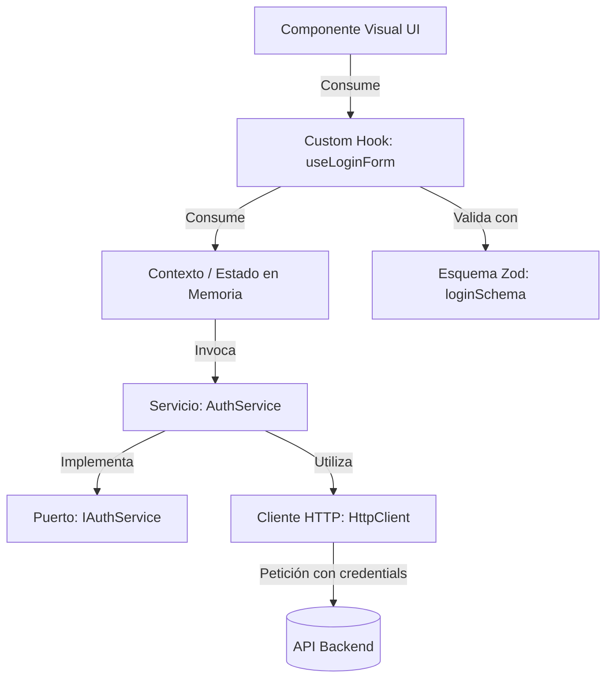
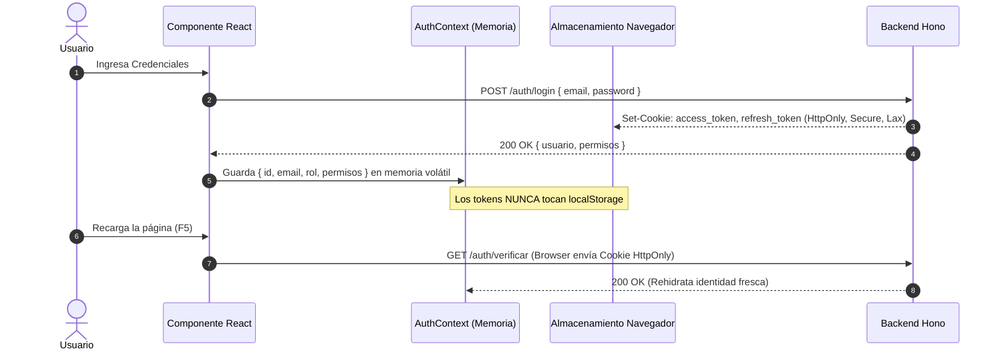

# Guía Maestra de Arquitectura Frontend — WarEngine

> **Audiencia:** Desarrolladores Frontend y Fullstack de WarEngine.  
> **Stack:** Next.js 16 (App Router) · React 19 · TypeScript estricto · Tailwind CSS v4 · Zod (`@warengine/contracts`).  
> **Patrón Arquitectónico:** Feature-Sliced Design (Vertical Slices) + Clean Frontend + Principios SOLID.

---

## Índice

1. [Visión General y Reglas Fundamentales](#1-visión-general-y-reglas-fundamentales)
2. [Estructura de Directorios](#2-estructura-de-directorios)
3. [Principios SOLID en React y Next.js](#3-principios-solid-en-react-y-nextjs)
4. [Flujo de Comunicación y Peticiones HTTP](#4-flujo-de-comunicación-y-peticiones-http)
5. [Estandarización en el Manejo de Errores](#5-estandarización-en-el-manejo-de-errores)
6. [Seguridad y Estado de Sesión (OWASP)](#6-seguridad-y-estado-de-sesión-owasp)
7. [Protección de Rutas (Edge Middleware)](#7-protección-de-rutas-edge-middleware)
8. [Checklist de Calidad para Pull Requests](#8-checklist-de-calidad-para-pull-requests)

---

## 1. Visión General y Reglas Fundamentales

Para garantizar que el frontend de WarEngine sea modular, seguro, mantenible y escalable, todo el equipo debe cumplir estrictamente estas directrices:

1. **Aislamiento Total del Backend:**
   * **PROHIBIDO** importar archivos desde `Backend/` (ni `@warengine/core`, ni drizzle, ni entidades backend).
   * La comunicación con el backend es **exclusivamente mediante HTTP REST** utilizando el cliente centralizado `apiClient`.
2. **Única Fuente de Verdad para Contratos y Validación:**
   * Todos los tipos de datos (DTOs) y esquemas de validación se importan desde `@warengine/contracts`.
   * **PROHIBIDO inventar expresiones regulares manuales** para validar correos, contraseñas, RUCs o montos si ya existe un esquema Zod en `@warengine/contracts`.
3. **Máximo de Líneas por Archivo:**
   * Ningún componente debe exceder las **200 - 250 líneas de código**. Si un archivo supera este umbral, debe descomponerse en subcomponentes atómicos o extraer su lógica a un custom hook.
4. **Seguridad Absoluta de Tokens:**
   * **NUNCA** almacenar tokens JWT (`accessToken`, `refreshToken`) en `localStorage` o `sessionStorage`. El robo de tokens por ataques XSS en `localStorage` es crítico.
   * La sesión se basa en **cookies `HttpOnly`** emitidas por el backend. En el frontend solo se almacena en memoria volátil (React Context) la identidad pública del usuario (`usuarioId`, `email`, `rolNombre`, `permisos`).

---

## 2. Estructura de Directorios

El frontend adopta una estructura modular vertical basada en **features** (módulos de negocio):

```
Frontend/src/
├── app/                                    # Enrutador App Router de Next.js
│   ├── (autenticacion)/                    # Rutas públicas de acceso (/acceso)
│   ├── (panel)/                            # Rutas administrativas (/dashboard, etc.)
│   ├── (punto-de-venta)/                   # Rutas de caja rápida (/pos)
│   ├── layout.tsx                          # Layout raíz con AuthProvider
│   └── page.tsx                            # Landing page corporativa
├── components/                             # Componentes transversales compartidos
│   └── ui/                                 # Primitivas visuales genéricas (Button3D, Navbar, Modal)
├── features/                               # Módulos verticales de negocio (Slices)
│   ├── autenticacion/                      # Módulo de referencia ya implementado
│   │   ├── api/                            # Servicios HTTP e interfaces (IAuthService, AuthService)
│   │   ├── components/                     # Componentes visuales específicos del módulo
│   │   ├── context/                        # Estado global del módulo (AuthContext, AuthProvider)
│   │   ├── hooks/                          # Custom hooks (useAuth, useLoginForm, usePermissions)
│   │   ├── types/                          # Contratos y tipos de dominio
│   │   └── index.ts                        # Punto de entrada público del feature
│   ├── landing/                            # Landing page modularizada
│   │   ├── components/                     # Hero, Alcance, Planes, PixelCard, NosotrosModal
│   │   ├── data/                           # Datasets y constantes estáticas aisladas de la vista
│   │   ├── types/                          # Contratos y tipos de datos del landing
│   │   └── index.ts                        # Punto de entrada público del feature landing
│   ├── facturacion/                        # Próximo módulo POS / Turnos de Caja
│   ├── inventario/                         # Próximo módulo Kardex / Productos
│   └── administracion/                     # Próximo módulo Sucursales / Empleados
├── lib/                                    # Infraestructura común
│   ├── api/                                # Cliente HTTP tipado, interceptores y ApiError
│   └── config/                             # Variables de entorno tipadas (env.ts)
└── middleware.ts                           # Protección de rutas perimetral en Edge
```

---

## 3. Principios SOLID en React y Next.js

Cada módulo debe diseñarse siguiendo el patrón utilizado en el módulo de `autenticacion`:



### 1. S — Single Responsibility Principle (Responsabilidad Única)
* **Un componente visual solo renderiza UI:** No debe contener llamadas `fetch` directas, ni validaciones complejas con regex, ni lógica pesada de cálculo.
* **La lógica de negocio vive en Custom Hooks:** Toda manipulación de estado, validación Zod y llamadas a servicios debe encapsularse en hooks específicos (ej. `useLoginForm`, `useInventarioFilter`).
* **La comunicación HTTP vive en Servicios:** Ningún hook ejecuta `fetch` manualmente; delega la llamada a un método de `AuthService` o `InventarioService`.

### 2. O — Open/Closed Principle (Abierto / Cerrado)
* Diseña componentes extensibles mediante **composición de React** (`children`, props de renderizado o variantes) en vez de llenar un componente con decenas de condicionales `if/else`.
* Si un componente requiere un nuevo paso (como el 2FA en el login), no modifiques la estructura interna del formulario de login; crea un subcomponente especializado (`TwoFactorStep.tsx`) y orquéstralo en el contenedor principal.

### 3. L — Liskov Substitution Principle (Sustitución de Liskov)
* Los componentes base de UI (ej. botones, inputs, selectores) deben extender las propiedades nativas de HTML (`React.ButtonHTMLAttributes<HTMLButtonElement>`).
* Cualquier componente personalizado debe ser un sustituto directo y confiable de la etiqueta nativa que representa.

### 4. I — Interface Segregation Principle (Segregación de Interfaces)
* Evita crear objetos o contextos monstruosos ("God Objects").
* No obligues a un componente a recibir props o depender de un contexto que no necesita. Ejemplo: `usePermissions()` expone exclusivamente helpers de autorización sin exponer métodos mutadores de sesión.

### 5. D — Dependency Inversion Principle (Inversión de Dependencias)
* Los componentes de alto nivel dependen de abstracciones, no de detalles concretos.
* Los servicios de frontend deben implementar interfaces (ej. `class AuthService implements IAuthService`).
* El servicio recibe el cliente HTTP por constructor (`constructor(private readonly http: IHttpClient = apiClient)`), lo que permite inyectar mocks durante pruebas unitarias.

---

## 4. Flujo de Comunicación y Peticiones HTTP

### 4.1 Uso Obligatorio de `apiClient`
Nunca uses `window.fetch` ni `axios` sueltos en componentes. Utiliza siempre la instancia centralizada `apiClient`:

```typescript
import { apiClient } from '@/lib/api';

// Petición tipada automática con cookies HttpOnly incluidas
const productos = await apiClient.get<ProductoDto[]>('/inventario/productos', {
  params: { sucursalId: 1, activo: true },
});
```

### 4.2 Ventajas Implementadas en `apiClient`:
1. **`credentials: 'include'`:** Garantiza que las cookies de sesión (`access_token`, `refresh_token`) viajen automáticamente en cada petición CORS hacia el backend.
2. **Silent Refresh Interceptor con Mutex:** Si un endpoint devuelve `401 Unauthorized` por expiración del access token (15 min), el cliente intenta renovar la sesión en `POST /auth/renovar-token` usando el refresh token y reintenta la petición original sin que el usuario note ninguna interrupción.

---

## 5. Estandarización en el Manejo de Errores

El backend de WarEngine devuelve errores de dominio estructurados. En el frontend, todos se capturan mediante la clase `ApiError`:

```typescript
import { ApiError } from '@/lib/api';

try {
  await authService.login(credentials);
} catch (error) {
  if (error instanceof ApiError) {
    if (error.isCredencialesInvalidas()) {
      mostrarError('Correo o contraseña incorrectos.');
    } else if (error.isLoginBloqueado()) {
      // HTTP 429 Too Many Requests por mitigación de fuerza bruta
      activarTemporizadorBloqueo(300);
    } else if (error.isRequiere2FA()) {
      // HTTP 428 Precondition Required
      pasarASegundoFactor(error.tempToken);
    } else {
      mostrarError(error.message);
    }
  } else {
    mostrarError('Error inesperado de red.');
  }
}
```

### Códigos Semánticos Clave del Backend:
| Código HTTP | Código Dominio Backend | Significado en UI |
|---|---|---|
| `400` | `VALIDATION_ERROR` | Payload rechazado por Zod. Resaltar inputs específicos en el formulario. |
| `401` | `CREDENCIALES_INVALIDAS` | Credenciales incorrectas. No detallar si falló el correo o la clave. |
| `401` | `USUARIO_INACTIVO` | Cuenta suspendida. Indicar contacto con soporte/TI. |
| `401` | `TOKEN_INVALIDO` | Sesión caducada o credenciales revocadas. Redirigir a `/acceso`. |
| `403` | `PERMISO_DENEGADO` | RBAC insuficiente. Mostrar aviso de acceso no autorizado. |
| `428` | `REQUIERE_2FA` | Se requiere código TOTP de 6 dígitos. Transicionar al formulario 2FA. |
| `429` | `LOGIN_BLOQUEADO` | Ataque de fuerza bruta mitigado. Mostrar cuenta regresiva de 5 min. |

---

## 6. Seguridad y Estado de Sesión (OWASP)



1. **Estado en Memoria Volátil:**
   * La sesión vive en `AuthContext`. Al recargar la página, se rehidrata automáticamente consultando `GET /auth/verificar`.
2. **Autorización Granular RBAC:**
   * Usa siempre el hook `usePermissions()` para condicionales de renderizado:
     ```typescript
     const { tienePermiso, esCajero } = usePermissions();
     
     return (
       <>
         {tienePermiso('inventario:crear') && <BotonCrearProducto />}
         {esCajero && <BotonAbrirTurnoCaja />}
       </>
     );
     ```

---

## 7. Protección de Rutas (Edge Middleware)

La seguridad perimetral se resuelve antes de que cualquier página privada sea procesada por React.

* **Archivo:** [`Frontend/src/middleware.ts`](src/middleware.ts)
* **Reglas obligatorias:**
  1. Si un usuario sin cookies `access_token` o `refresh_token` intenta ingresar a `/dashboard`, `/pos`, `/inventario`, etc., es redirigido a `/acceso?redirect=<ruta_solicitada>`.
  2. Si un usuario autenticado intenta entrar a `/acceso`, se le redirige automáticamente a su zona de trabajo.
  3. Si un cajero (`rolId: 3`) intenta entrar a `/dashboard`, se le redirige a `/pos`.
  4. Si un administrador intenta entrar a `/pos`, se le redirige a `/dashboard`.

---

## 8. Checklist de Calidad para Pull Requests

Antes de solicitar revisión de código en el frontend, verifica:

- [ ] ¿El nuevo código está ubicado dentro de su `feature/` correspondiente (`api/`, `components/`, `hooks/`, `types/`)?
- [ ] ¿Los componentes tienen menos de 250 líneas y delegan la lógica a hooks?
- [ ] ¿Todos los formularios utilizan un esquema Zod de `@warengine/contracts` para validación?
- [ ] ¿Todas las llamadas a la API utilizan `apiClient` y manejan `ApiError` adecuadamente?
- [ ] ¿Se verificó que ningún token se guarde en `localStorage` o `sessionStorage`?
- [ ] ¿Se agregaron los guardias de permisos necesarios con `usePermissions()`?
- [ ] ¿El comando `npm run build` compila con cero advertencias y cero errores de TypeScript?
